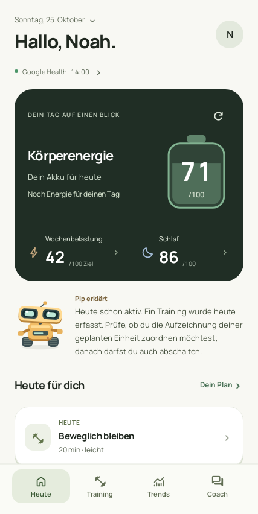
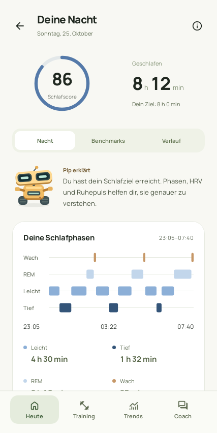
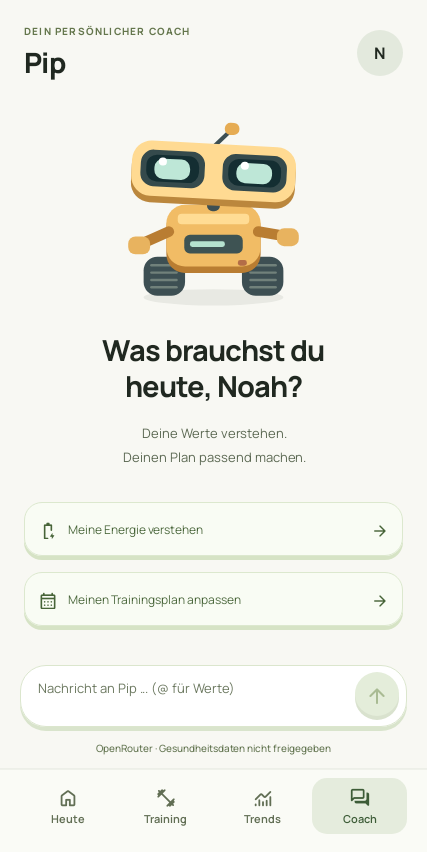
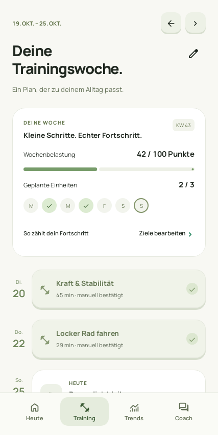
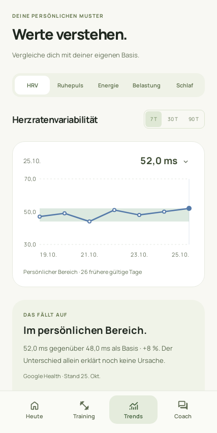
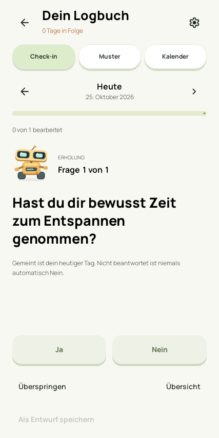

# ROCO — persönliche Scores und KI-Coaching für Google Health

**Mach aus deinen Google-Health-Daten verständliche Scores, visuelle Auswertungen und persönliches KI-Coaching.** ROCO ist dein Android-Begleiter für Körperenergie, Schlaf, HRV, Erholung und Wochenbelastung — damit du deine Werte verstehst und deinen Alltag besser planen kannst.

<p align="center">
  <a href="https://github.com/wabbo-hundeluft/ROCO/releases/download/v2.0.20/ROCO-2.0.20.apk"></a>
  <a href="https://github.com/wabbo-hundeluft/ROCO/releases"></a>
  <a href="https://github.com/wabbo-hundeluft/ROCO/releases/tag/v2.0.20"></a>
</p>

## Wofür ist ROCO da?

Deine Uhr erfasst die Messwerte. **ROCO hilft dir, sie einzuordnen:** mit lokal berechneten Scores, Vergleichen zu deinem eigenen Verlauf und optionalen KI-Gesprächen über deine Gesundheits- und Trainingsdaten. Frag deinen Roboter etwa „Warum ist meine Energie heute niedrig?“, schau dir die Einflussfaktoren deines Schlafscores an oder besprich deinen Trainingsplan.

- **Scores für Google-Health-Daten:** Körperenergie, Schlaf und adaptive Wochenbelastung mit Diagrammen und erklärten Einflussfaktoren.
- **KI für deine Google-Health-Daten:** Besprich verfügbare HRV-, Ruhepuls-, Schlaf- und Trainingswerte sowie Logbuchmuster mit deinem selbst benannten Roboter-Coach.
- **Von der Auswertung zur Planung:** Trainings- und Ruhetage planen, die kommende Nacht vorbereiten und Gewohnheiten im Logbuch verfolgen.

Google Health ist die bevorzugte eingerichtete Datenverbindung; **Health Connect dient als Ersatz**. ROCO berechnet eigene Scores und zeigt keine offiziellen Google-Scores an. Das KI-Coaching ist optional und verwendet deine eigenen Anbieter-API-Keys.

ROCO ist eine unabhängige App, kein offizielles Google-Produkt und nicht mit Google verbunden.

[English README](README.md)

## Einblicke in die App

Beispielansichten aus automatisierten UI-Tests mit synthetischen Daten.

<p align="center">






</p>

## APK herunterladen

[ROCO 2.0.20 als APK herunterladen](https://github.com/wabbo-hundeluft/ROCO/releases/download/v2.0.20/ROCO-2.0.20.apk) · [Alle Releases](https://github.com/wabbo-hundeluft/ROCO/releases). Die Vorschau unterstützt Android 9 / API 28 oder neuer; verfügbare Gesundheitsdaten hängen von Gerät, Apps und Datenverbindung ab.

Die App heißt **ROCO**. Ihr aktuelles Paket lautet `com.wabbos.healthcoach.v2preview`; die APK ist mit einem Entwicklungszertifikat signiert. Ein Update über dieselbe Installation erhält lokale Daten. APKs mit anderem Paket oder anderer Signatur können sie nicht direkt aktualisieren. Die Prüfsumme steht in `SHA256SUMS.txt` bei der Veröffentlichung.

## Funktionen

- Dynamische Körperenergie mit Akkudarstellung und Tagesverlauf.
- Adaptive Wochenbelastung: 100 Punkte entsprechen deinem persönlichen Wochenziel. Einzelne Trainings zeigen ihren Beitrag.
- Schlafdetails, Schlafphasen, persönliche Vergleiche und Schlafplaner für die kommende Nacht.
- Gemeinsamer Vitalwerte-Check mit persönlichen Vergleichsbereichen.
- Eigene Trainingsziele, Planung und erledigte Einheiten.
- Logbuch mit vorgefertigten und eigenen Fragen, Check-in-Streak und lokalen Gewohnheiten-Mustern.
- Frühere Tage und interaktive Verläufe über 7, 30 und 90 Tage.
- Ein benennbarer Roboter mit programmierten, situationsbezogenen Animationen, morgendlichem Ausfahren und Schlafmodus.
- Neuer Chat mit großer Begrüßung und Möglichkeit, den vorherigen Chat fortzusetzen.

## Sprache und KI

Unter **Profil → Sprache → App-Sprache** wählst du Systemsprache, Deutsch, English, Français oder Español. Nicht unterstützte Systemsprachen verwenden Englisch.

KI ist optional. Trage eigene API-Keys für **Groq, Mistral, OpenRouter und Gemini** ein und wähle ein Modell. Bei Fehlern versucht ROCO konfigurierte Ersatzanbieter in dieser Reihenfolge. Jede Folgeanfrage erhält einen kurzen lokalen Rückblick auf den letzten Austausch. Kostenlose Kontingente und Modellzugang hängen vom jeweiligen Anbieter ab.

## Datenverbindung

ROCO bevorzugt eine eingerichtete Google-Health-Verbindung und nutzt Health Connect als Ersatz. Für den direkten Google-Zugang ist eine passende Google-Cloud-/OAuth-Konfiguration nötig; nicht jedes Konto hat automatisch Zugriff. Health Connect benötigt kompatible Software und tatsächlich importierte Daten deiner Uhr oder Apps.

Scores, Logbuch, Pläne, Chat und API-Einstellungen werden lokal authentifiziert verschlüsselt gespeichert. Für Google-Import und optionale KI-Anfragen wird eine Netzwerkverbindung verwendet. Den persönlichen Datenzugriff des Coachs steuerst du in den Einstellungen.

Die Scores sind eigene Wellness-Schätzungen und keine medizinischen Messungen oder Diagnosen. Fehlende Daten können einzelne Scores verhindern. Muster im Logbuch belegen keine Ursache. ROCO übernimmt keine proprietären WHOOP- oder Garmin-Algorithmen.

## Rückmeldungen

Dies ist eine frühe Vorschau. Nenne bei Fehlerberichten App-Version, Android-Version, Datenquelle und die Schritte zum Nachstellen. Poste keine API-Keys oder persönlichen Gesundheitsdaten in öffentlichen Issues.

## Build from source

The complete Android application, score engines, robot drawing code and tests are in this repository.

Requirements: JDK 21 (or a compatible Android Studio bundled JDK), Android SDK Platform 37, and the SDK tools required by the Android Gradle plugin. Gradle 9.6.0 is provided through the wrapper. Set `ANDROID_HOME` to your SDK path or create an untracked `local.properties` with `sdk.dir`.

```sh
git clone https://github.com/wabbo-hundeluft/ROCO.git
cd ROCO
./gradlew :app:assembleDebug -PhealthCoachPreview=true
./gradlew :app:testDebugUnitTest -PhealthCoachPreview=true
```

APK output: `app/build/outputs/apk/debug/app-debug.apk`. Omit the preview property to build package `com.wabbos.healthcoach`; the distributed preview uses `com.wabbos.healthcoach.v2preview`. Your local debug certificate differs from the published APK certificate, so a locally built APK cannot update that APK directly. No signing key is included.

No API keys are needed to compile. Enter optional AI provider keys in the app. Direct Google Health access requires your own eligible Google Cloud Android OAuth configuration matching the package and SHA-1 of your signing certificate; it is not provisioned by cloning this repository.

### Source map

- `app/src/main/`: application, local score algorithms, health connectors, AI providers, Compose screens, robot animation and translations.
- `app/src/test/`: unit, regression and synthetic UI tests.
- `android-contract/`: score-engine contract.
- `gradle/`: pinned dependency catalog and wrapper.

## Lizenz

ROCO ist vollständig Open Source unter der **[Apache-Lizenz 2.0](LICENSE)**. Du darfst den eigenen Projektcode unter deren Bedingungen verwenden, verändern und weitergeben. Fremde Schriftarten und Komponenten behalten ihre jeweiligen Lizenzen; siehe [Drittanbieter-Hinweise](THIRD_PARTY_NOTICES.md).
